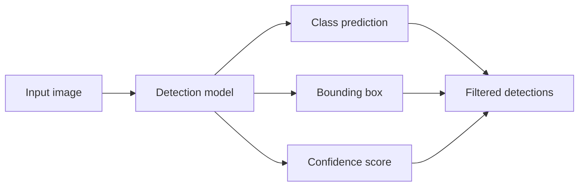

# Object detection fundamentals

Object detection finds instances of specified object classes in an image and estimates where each instance is located. A detection usually contains:

- **Class** — the object category, such as a person or vehicle.
- **Bounding box** — a rectangle locating that object in the image.
- **Confidence score** — the model's score for the prediction.

An image can produce zero, one, or many detections.

## Detection compared with classification

Image classification assigns labels to an entire image. Object detection also locates each object, so it can distinguish multiple instances and show where they appear. Instance segmentation goes a step further by predicting a pixel-level shape instead of only a rectangle.

## Detection flow

The model's raw predictions are filtered using confidence thresholds and duplicate-box handling. The resulting detections can be drawn on the image or passed to another part of an application.

## Bounding boxes

A box can be represented in several formats, for example as the top-left and bottom-right corners `(x_min, y_min, x_max, y_max)` or as center coordinates plus width and height `(x_center, y_center, width, height)`. Some formats use pixels; others normalize coordinates to the image dimensions. The project must use the format expected by its annotation and training tools.

## Important distinction

A confidence score is not a calibrated probability that a prediction is correct. Its meaning depends on the model and thresholding procedure, so thresholds should be selected using validation data and checked against the intended use case.
